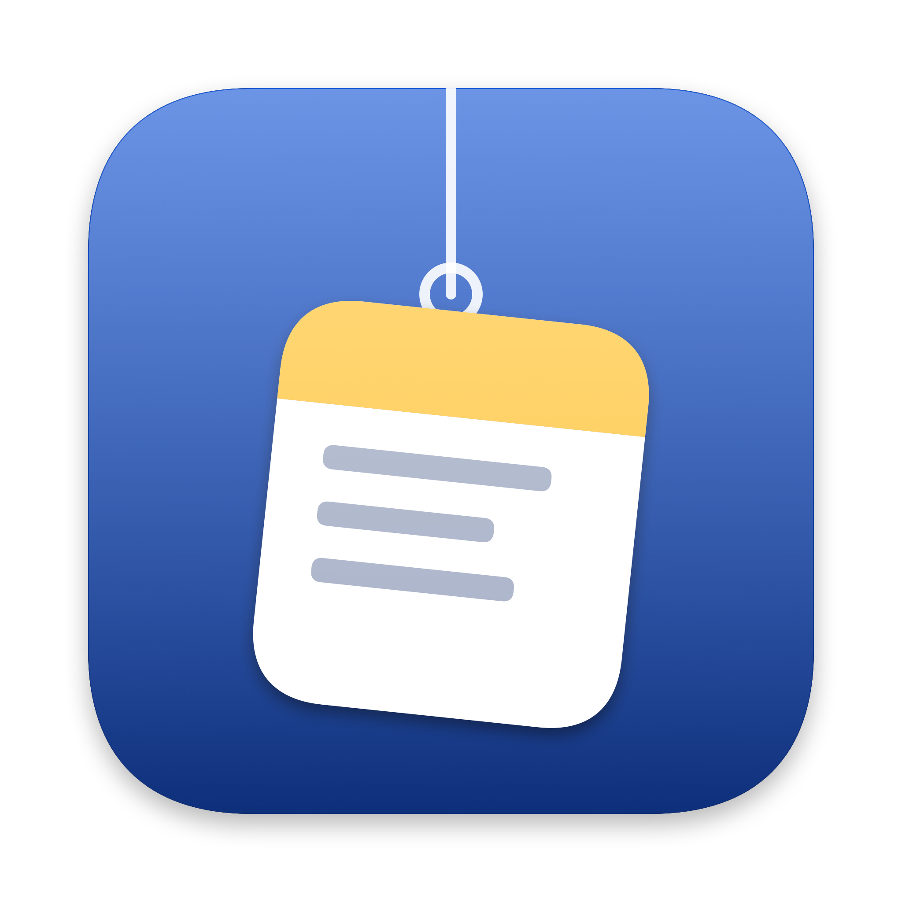
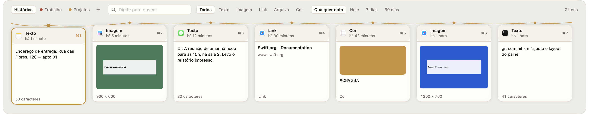

<p align="center"></p>

<h1 align="center">Colar</h1>

<p align="center">Gerenciador de área de transferência para macOS. Tudo o que você copia fica num painel no <b>⌘⇧V</b>,<br>
com busca, pinboards, prévia e colagem direta no app que você está usando.</p>



> "Colar" é colar (*paste*) e também colar de contas: os itens copiados são as contas de um fio.

## O que ele faz

- **Histórico de tudo que você copia:** texto, texto formatado, links, cores, imagens e arquivos, com o app de origem.
  Copiar de novo a mesma coisa sobe o item para o topo, sem duplicar.
- **Painel no ⌘⇧V** na base da tela, sem tirar o foco do app em que você está: Enter cola direto nele.
- **Busca** enquanto você digita, sem ligar para acento e com prefixo ("plan" acha "planilha"). Acha também o
  **texto dentro das imagens** (OCR local) e o título das páginas dos links.
- **Filtros** por tipo (Tab alterna) e por período (hoje, 7 dias, 30 dias).
- **Pinboards** com nome e cor: arraste um cartão até a aba para fixar. Item fixado não some pela limpeza automática.
- **Prévia** grande no Espaço: texto inteiro, imagem no tamanho original, link com título e imagem da página.
- **Editar** (⌘E) título e texto de um item, e **criar** um item novo (⌘N).
- **Fila de colagem** (⇧⌘C): o que você copia entra numa fila, e cada ⌘V cola o próximo, na ordem.
- **Privacidade:** não guarda senhas nem conteúdo marcado como temporário ou gerado por app (convenção
  [nspasteboard.org](http://nspasteboard.org)), nem o que vem do iPhone pelo Universal Clipboard. Dá para pausar a
  captura e ignorar apps. O painel não aparece em print nem em compartilhamento de tela, a não ser que você permita.
- **Limpeza automática** do histórico: dia, semana, mês (padrão), ano ou para sempre.

## Atalhos

| Onde | Tecla | O quê |
|---|---|---|
| Qualquer app | ⌘⇧V | abre e fecha o painel |
| Qualquer app | ⇧⌘C | liga e desliga a fila de colagem |
| Painel | ← → | escolhe o item |
| Painel | ↩ / ⌘1…9 | cola o item no app de baixo |
| Painel | ⇧↩ / ⇧⌘1…9 | cola sem formatação |
| Painel | digitar | busca |
| Painel | Tab / ⇧Tab | troca o filtro de tipo |
| Painel | ⌘← ⌘→ | troca entre Histórico e pinboards |
| Painel | Espaço | prévia grande (com a busca vazia) |
| Painel | ⌘E / ⌘N | edita o item / cria um item |
| Painel | ⌥↩ | põe o item na fila de colagem |
| Painel | ⌘⌫ | apaga o item |
| Painel | Esc | limpa a busca; de novo, fecha |

O menu na barra de menus tem: pausar captura, colar no app ativo ou só copiar, sempre colar sem formatação, efeitos
sonoros, tempo do histórico, permitir print do painel e apagar o histórico.

## Instalar

Requer **macOS 14 ou mais novo**.

### Baixando o app

1. Baixe o `Colar.zip` da [página de releases](../../releases) e descompacte.
2. Arraste o `Colar.app` para **Aplicativos**.
3. O app não é notarizado pela Apple, então o macOS bloqueia a primeira abertura. Libere com:
   ```sh
   xattr -dr com.apple.quarantine /Applications/Colar.app
   ```
   ou clique com o botão direito no app → **Abrir**.
4. Na primeira vez, libere o Colar em **Ajustes do Sistema → Privacidade e Segurança → Acessibilidade**. Sem isso ele
   só copia o item, e você cola com ⌘V.

### Compilando

Só precisa das Command Line Tools (não precisa do Xcode completo):

```sh
git clone https://github.com/RenzoTakada/colar.git
cd colar
scripts/testar.sh                  # compila, roda os testes e monta o .app
scripts/bundle.sh release install  # instala em /Applications
```

O `bundle.sh` assina com um certificado "Apple Development" do seu keychain, se houver (assim a permissão de
Acessibilidade sobrevive a cada build). Sem certificado, ou com `COLAR_ADHOC=1`, assina ad hoc.

## Onde ficam os dados

Tudo fica no seu Mac, nada vai para servidor nenhum:

- histórico: `~/Library/Application Support/Colar/` (SQLite + arquivos dos itens)
- diário de eventos: `~/Library/Logs/Colar/colar.log` (não registra o conteúdo copiado nem o que você digita)

A única conexão de rede é a prévia de links: quando você copia um link, o Colar busca o título e a imagem daquela
página. Não há telemetria.

## Como é feito

Swift + SwiftUI/AppKit, SwiftPM puro, sem dependências externas.

| Parte | Como |
|---|---|
| captura | `NSPasteboard.changeCount` a cada 0,5 s, todos os tipos do item guardados para recolar idêntico |
| banco | SQLite (WAL) com FTS5 sem acento; arquivos endereçados por SHA-256 |
| painel | `NSPanel` não ativador (recebe o teclado sem tirar o foco do app de baixo) |
| atalho | Carbon `RegisterEventHotKey` |
| colar | `CGEvent` ⌘V na tecla do V do layout atual (funciona em Dvorak) |
| OCR | Vision, local, português e inglês |
| fila de colagem | `CGEventTap` só enquanto a fila está ligada |
| ícone e sons | gerados por código (`design/icone.swift`, `design/sons/gerar.py`) |

Testes: `scripts/testar.sh` (162 checks, sem tocar no seu clipboard real nem no seu histórico).

## Licença

[MIT](LICENSE).
